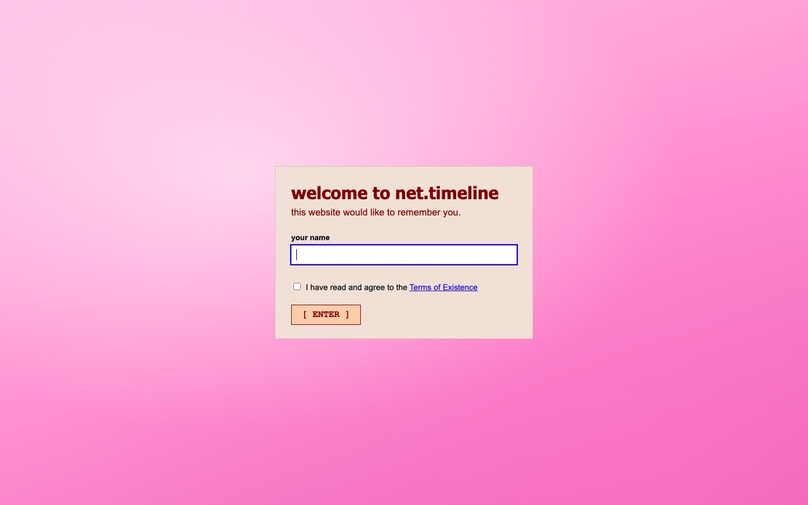
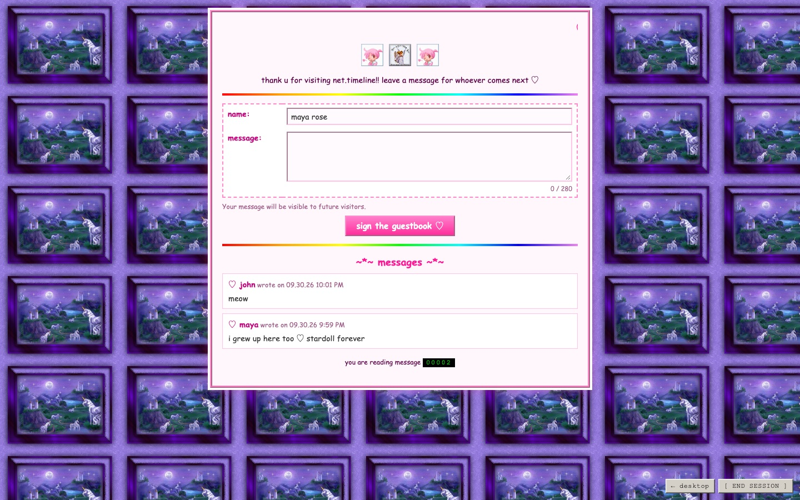

# net.timeline

*this website would like to remember you.*


net.timeline is a website about growing up as a girl online, and about the internet as a living archive of every self you made there. it is a collection of portals: Stardoll and Pixie Hollow, a webcam that turns you into text, ads that already know you, a camera that reads you back. every visit is remembered, and every time it's exhibited the archive grows.

→ [net-timeline.netlify.app]([https://net-timeline.netlify.app/enter/])


---

## enter



you give your name and agree to the **Terms of Existence**, which you will not read!

then you log in to a 2012 desktop. the browser is already open on the board, the library, the guestbook, and everyone who came before you. the portals sit on the desktop like icons. each one leads into the next and they're yours to explore

---

## my favorite portals

### nostalgia, looped


### sponsored


### surveilled


---

## leaving

### the cache


when you end your session (or it ends for you), the site shows you what it noticed: how long you stayed, where you lingered, how many times you clicked, how long you spent deciding where to go next, how many times you considered leaving.

### previous visitors & the guestbook




traces of everyone who came before you: a first name, a date, how long they stayed, whether they left something behind

---

## what is kept

the cache is meant to feel far more invasive than what is actually kept. the work critiques how casually we surrender privacy without actually violating it.

| | shown to you, once | kept in the archive | public |
|---|---|---|---|
| name | ✓ | ✓ | first name only |
| when you came, how long you stayed | ✓ | ✓ | date + length of stay |
| portals | ✓ | how many | — |
| your terms choice | ✓ | ✓ | — |
| clicks, movement, hesitation, revisits | ✓ | ✗ | — |
| guestbook message | ✓ | ✓ | ✓ |
| your face | live only | ✗ | ✗ |

everything detailed lives on the computer in front of you and is wiped when the next visitor arrives. camera frames are read to draw the screen and then thrown away and nothing is saved or sent anywhere

---

## exhibited

**Our Images Under Imperialism**, a pop-up exhibition by the Shadowbanned Cultural Workers Lab.

---

## for the operator

```bash
python3 serve.py        # http://localhost:8765, with stand-ins for the archive + guestbook
```

- deployed on Netlify from `main`. the archive and guestbook are Netlify Functions in `netlify/functions/`, stored in Netlify Blobs.
- the guestbook operator page lives at `/guestbook/admin/` and needs `GUESTBOOK_ADMIN_KEY` set in Netlify's environment variables.
- **ctrl + option + shift + R** resets the station to a fresh session from any page.
- timings (idle timeout, reset) can be tuned on site from the browser console:
  `localStorage.setItem('nt.config', JSON.stringify({ idleMs: 120000 }))`

```
enter/       the gate + the 2012 desktop
board/       the old board: statement, boards, the house
clickme/     nostalgia, looped
asciiHero/   mirror
ads/         sponsored
surveilled/  surveilled
cache/       the record
archive/     previous visitors
guestbook/   sign my guestbook!!! ♡
session/     the session: tracking, END SESSION, idle, the archive queue
```

---

the ChiaHouse on the board lives at [las-pinas.com](https://las-pinas.com), by Chia Amisola. the reading that shaped this lives in the [library](https://h4nnah.net/lib/).

navigate this liminal space as you wish. digitally knitted with love by hannah #mmmpurehtml
