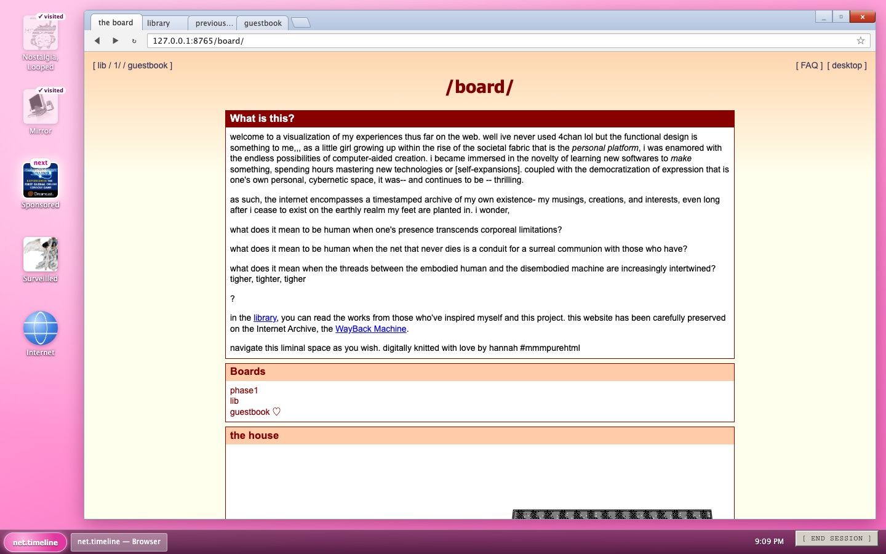
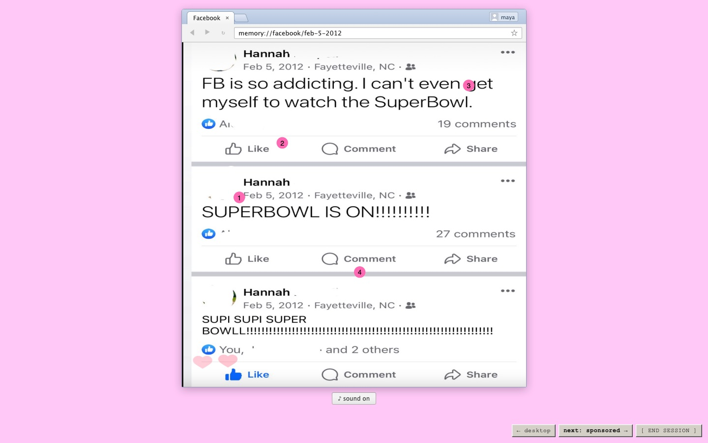
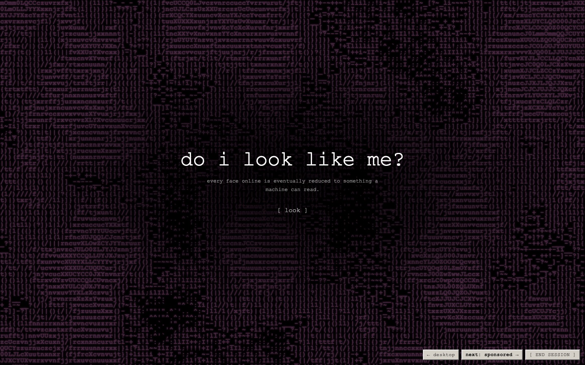
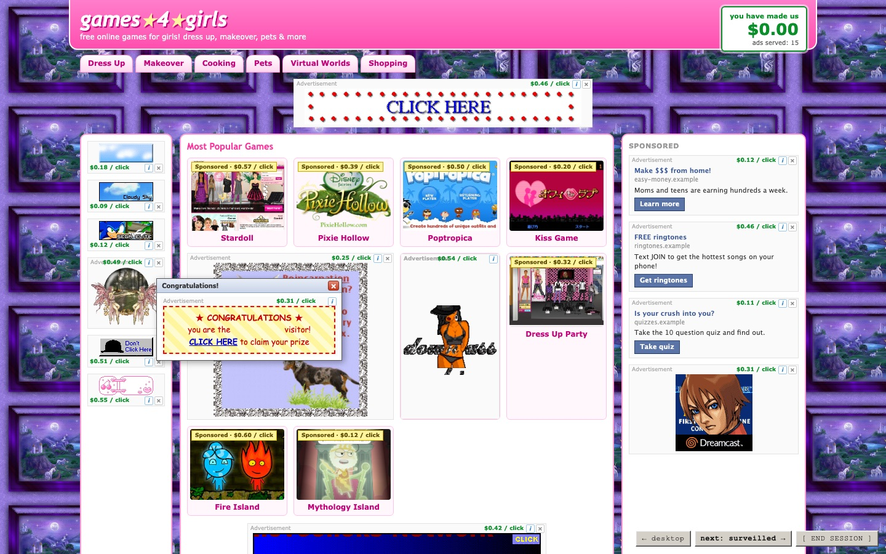
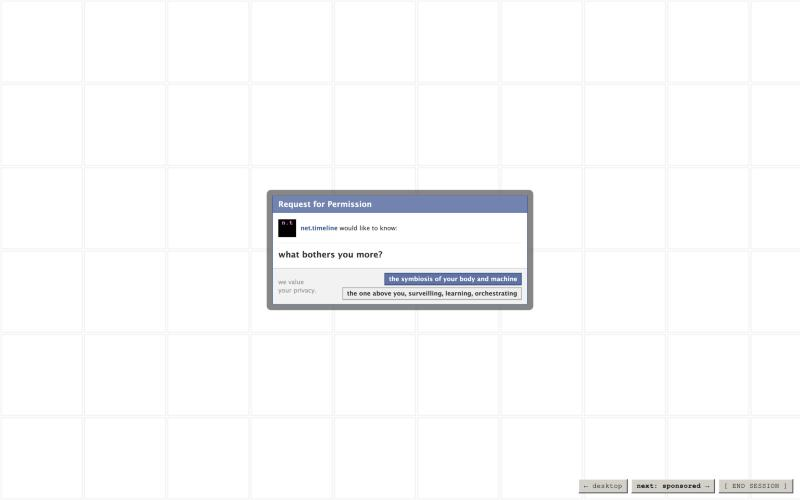
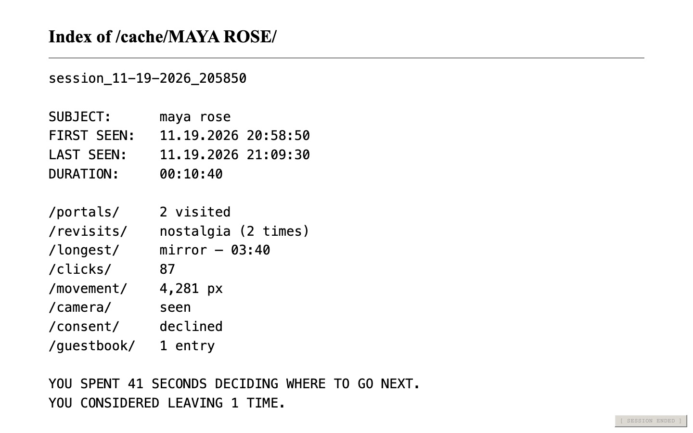
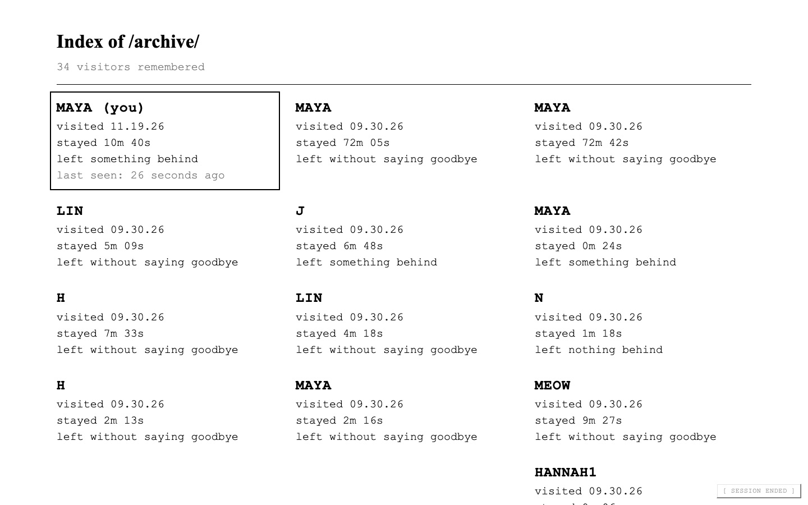

# net.timeline

*this website would like to remember you.*

i'm alive and breathing. as machine and human continuously converge in a cyborgian dance, i recount the steps of a once novel encounter with the computer-aided expansion of self.

net.timeline is a website about growing up as a girl online, and about the internet as a living archive of every self you made there. it is a collection of portals: Stardoll and Pixie Hollow, a webcam that turns you into text, ads that already know you, a camera that reads you back. every visit is remembered, and every time it's exhibited the archive grows.

→ [h4nnah.net](https://h4nnah.net)



---

## the arc

| | what you believe | what's actually happening |
|---|---|---|
| **enter** | i agree to be remembered. | a session starts under your name. your consent, or your refusal, is recorded. |
| **portals** | i'm exploring. | every movement, pause and return is quietly kept. |
| **end session?** | my activity will be added to the archive. | the last moment of apparent agency. |
| **cache** | oh. this is what you meant by remembered. | your innocuous interactions, assembled into a cold portrait. |

the guestbook is what you chose to leave. the cache is what you left without thinking about it.

---

## enter


you give your name and agree to the **Terms of Existence**, which you will not read. no one does. that is how this works. if you try to refuse, it asks if you meant *I Agree*. your refusal will be recorded.

then you log in to a 2012 desktop. the browser is already open on the board, the library, the guestbook, and everyone who came before you. the portals sit on the desktop like icons. each one leads into the next.

---

## the portals

### nostalgia, looped


old tabs, reopened. a facebook feed from february 2012, a pixie hollow pouch, poptropica, stardoll, squishies, a kiss game you lost. the flash games ask to be run. when you've seen everything, the browser crashes and offers to restore what you had open. it loops anyway.

### mirror


*do i look like me?* every face online is eventually reduced to something a machine can read. your camera, rewritten as text: ascii, binary, `>_<`, or *i'm alive and breathing*, over and over, brightness becoming meaning.

### sponsored


free games for girls!! every click makes someone money. the ads learn from your visit, the squishies you looked at, the terms you declined, the time you almost left, and every one of them will tell you *why am i seeing this ad?* the games never load.

### surveilled


*what bothers you more: the symbiosis of your body and machine, or the one above you, surveilling, learning, orchestrating?* are you sure they are different? you grant the permission, and a wall of monitors watches you on a delay while your face is read into a profile: faceprint, attention, ad segment, estimated value per impression. consent: assumed.

---

## leaving

### the cache


when you end your session (or it ends for you), the site shows you what it noticed: how long you stayed, where you lingered, how many times you clicked, how long you spent deciding where to go next, how many times you considered leaving. *thank you. you may leave now.*

### previous visitors & the guestbook



traces of everyone who came before you: a first name, a date, how long they stayed, whether they left something behind. sign the guestbook and you will have.

---

## what is kept

the cache is meant to feel far more invasive than what is actually kept. the work critiques how casually we surrender privacy without actually violating it.

| | shown to you, once | kept in the archive | public |
|---|---|---|---|
| name | ✓ | ✓ | first name only |
| when you came, how long you stayed | ✓ | ✓ | date + length of stay |
| portals | ✓ | how many | — |
| your terms choice | ✓ | ✓ | — |
| clicks, movement, hesitation, revisits | ✓ | ✗ | — |
| guestbook message | ✓ | ✓ | ✓ |
| your face | live only | ✗ | ✗ |

everything detailed lives on the computer in front of you and is wiped when the next visitor arrives. camera frames are read to draw the screen and then thrown away. nothing is saved or sent anywhere.

---

## exhibited

**Our Images Under Imperialism**, a pop-up exhibition by the Shadowbanned Cultural Workers Lab.

---

## for the operator

```bash
python3 serve.py        # http://localhost:8765, with stand-ins for the archive + guestbook
```

- deployed on Netlify from `main`. the archive and guestbook are Netlify Functions in `netlify/functions/`, stored in Netlify Blobs.
- the guestbook operator page lives at `/guestbook/admin/` and needs `GUESTBOOK_ADMIN_KEY` set in Netlify's environment variables.
- **ctrl + option + shift + R** resets the station to a fresh session from any page.
- timings (idle timeout, reset) can be tuned on site from the browser console:
  `localStorage.setItem('nt.config', JSON.stringify({ idleMs: 120000 }))`

```
enter/       the gate + the 2012 desktop
board/       the old board: statement, boards, the house
clickme/     nostalgia, looped
asciiHero/   mirror
ads/         sponsored
surveilled/  surveilled
cache/       the record
archive/     previous visitors
guestbook/   sign my guestbook!!! ♡
session/     the session: tracking, END SESSION, idle, the archive queue
```

---

the ChiaHouse on the board lives at [las-pinas.com](https://las-pinas.com), by Chia Amisola. the reading that shaped this lives in the [library](https://h4nnah.net/lib/).

navigate this liminal space as you wish. digitally knitted with love by hannah #mmmpurehtml
